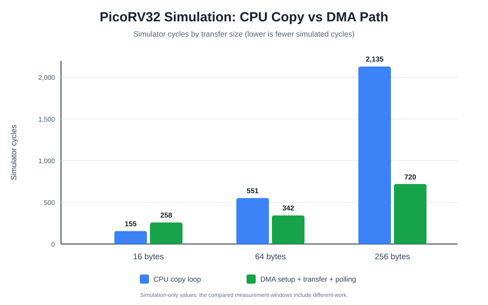

# RISC-V DMA Controller

**Design and Verification of a Fault-Contained RISC-V DMA Controller with Bare-Metal Firmware Driver**

A laptop-only RTL and firmware project implementing a single-channel, 32-bit memory-to-memory DMA controller in SystemVerilog, integrated with an external PicoRV32 RISC-V core and bare-metal C firmware.

The project is simulation-verified. It is not an FPGA implementation or a physical-hardware benchmark.

## What it demonstrates

- Memory-mapped DMA configuration and status registers
- Five-word descriptors and bounded descriptor chaining (up to 256 descriptors)
- Descriptor, alignment, length, SRAM-range, overlap and control-field checks
- Single-outstanding valid/ready memory transactions
- CPU/DMA round-robin arbitration with grant retention under backpressure
- DONE, FAULT and ABORT status/interrupt signalling
- Transaction-boundary abort and restart/recovery behavior
- Bare-metal C driver and PicoRV32 firmware integration
- Python reference-model tests and self-checking SystemVerilog testbenches

## Architecture

```text
Bare-metal C firmware
        |
     PicoRV32
        |
  System fabric
   |         |
DMA regs  CPU/DMA round-robin arbiter
              |
          Shared SRAM
```

PicoRV32 is an upstream CPU core, not a custom CPU designed in this project. The DMA subsystem, system fabric, arbiter, SRAM simulation model, firmware driver and verification collateral are the project work.

## CPU-vs-DMA simulator-cycle results



| Transfer size | CPU copy loop | DMA setup + transfer + polling |
|---|---:|---:|
| 16 bytes | 155 cycles | 258 cycles |
| 64 bytes | 551 cycles | 342 cycles |
| 256 bytes | 2,135 cycles | 720 cycles |

Interpretation: for 16 bytes, the DMA path costs more because setup and polling dominate. At 64 and 256 bytes, fewer simulator cycles were recorded for the DMA path in this particular testbench. The CPU baseline measures the copy loop; the DMA result includes setup, transfer and polling. These figures are **simulator cycles**, not physical throughput, latency or power measurements.

## Validation record

The project owner reported the following Windows/MSYS2 UCRT64 acceptance results on 2026-11-09:

| Verification stage | Result |
|---|---:|
| Python reference-model tests | 26 passed |
| Extended DMA RTL scenarios | 8 passed |
| CPU/DMA arbiter testbench | Passed |
| Clang RV32 bare-metal firmware build | Passed |
| PicoRV32 + DMA integration simulation | Passed |
| Combined acceptance target | Passed |

See [the full validation record](docs/current_validation.md). Icarus emitted non-fatal constant-select notices in `always_*` blocks; the reported builds and simulations completed successfully.

## Repository layout

- `rtl/` — DMA controller, arbiter, simulation SRAM, system fabric and PicoRV32 SoC wrapper
- `firmware/` — bare-metal C driver, benchmark firmware, startup and linker script
- `tb/` — DMA, arbiter and PicoRV32 integration testbenches
- `model/` — independent Python descriptor-validation reference model
- `tests/` — Python unit tests
- `scripts/` — build/test helpers, memory-image conversion and PicoRV32 fetch script
- `docs/` — architecture, register map, setup, walkthrough, validation and known limitations
- `docs/evidence/` — CPU-vs-DMA simulator-cycle chart

## Build and run

Recommended environment: MSYS2 UCRT64 on Windows, or a compatible Linux environment, with Python 3, GNU Make, Icarus Verilog/VVP, Clang/LLD, LLVM objcopy, Git and GTKWave.

Fetch the upstream CPU source:

```sh
bash scripts/get_picorv32.sh
```

For exact reproducibility of the reported run, use PicoRV32 commit:

```text
ef203c2b0a3fb793280f5114941416c425c5b461
```

Run the acceptance stages:

```sh
python -m unittest discover -s tests -v
make test-rtl
make test-arbiter
make firmware-clang
make test-cpu-clang
make test-system-clang
```

See [Windows setup](docs/windows_setup.md) and [demo walkthrough](docs/demo_walkthrough.md) for more details.

## Viewing waveforms

The simulations generate VCD traces under `build/`:

```sh
gtkwave build/dma_extended.vcd
gtkwave build/picorv32_dma.vcd
```

The extended DMA waveform shows clock/reset, register accesses, memory handshakes, addresses, controller-state progression, completion, faults and abort behavior over simulation time. The VCDs are generated by the testbenches and are not committed as pre-generated waveform files.

See [the output guide](docs/graph_and_output_guide.md) for how to interpret the benchmark chart and waveforms.

## Scope and known limitations

- One DMA channel; 32-bit word-aligned memory-to-memory transfers only
- No AXI, burst transfers, cache coherence, multiple channels or byte-granular transfer support
- SRAM-window validation is not a full IOMMU or system-wide MPU
- Abort is transaction-boundary controlled; an already committed write is not rolled back
- Descriptor chains are not atomic; earlier completed descriptors remain completed if a later one faults
- No FPGA synthesis, place-and-route, timing closure, formal verification, board test or silicon validation is claimed
- PicoRV32 is fetched separately; it is not vendored in this repository

Read [known limitations](docs/known_limitations.md) before interpreting or presenting the results.

## Third-party attribution

PicoRV32 is maintained by YosysHQ. The upstream ISC license text is retained at [third_party/PICORV32_COPYING.txt](third_party/PICORV32_COPYING.txt). The fetch script downloads upstream source separately.
